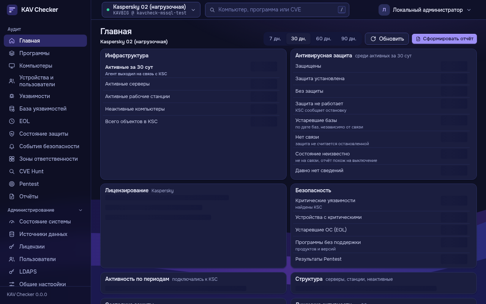
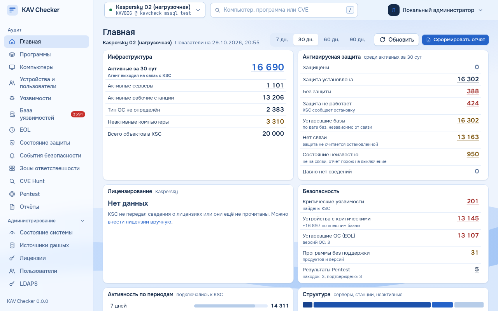
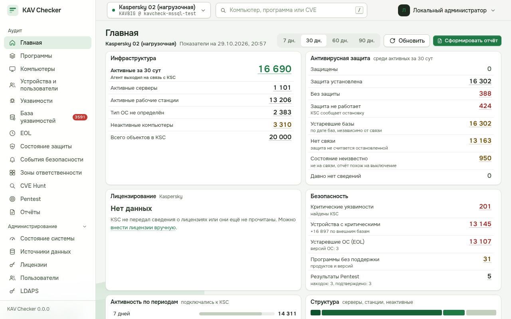
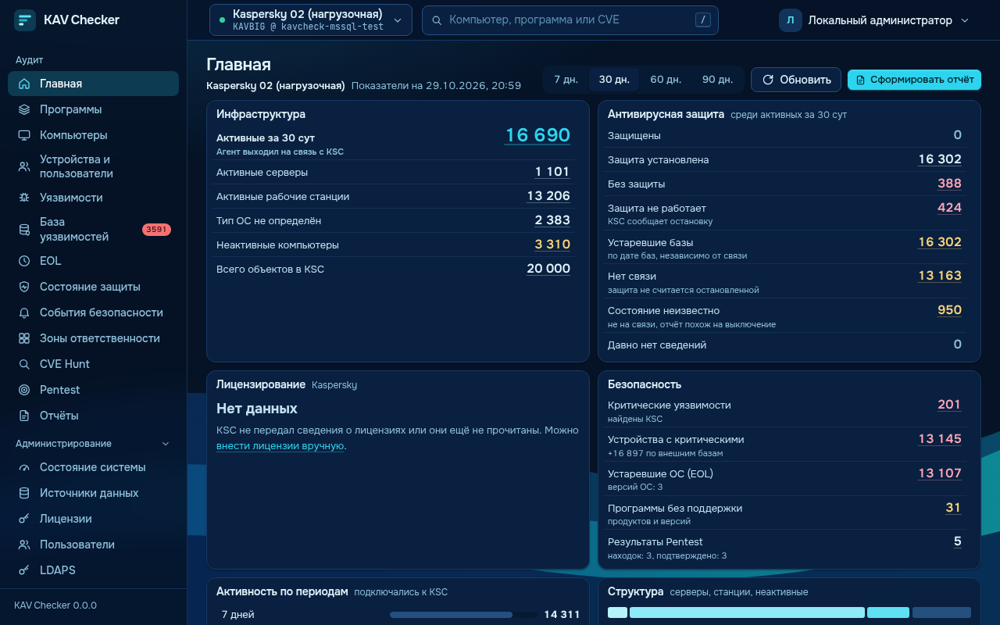

# UX/UI-аудит 0.16.0: вся система глазами пользователя, отчёты во всех разделах, четыре темы оформления

Проверено 29.10.2026 в настоящем браузере (agent-browser, Chromium) на стенде с синтетическими данными: источник KSC на 20 тыс. компьютеров, 5,8 млн обнаружений в подготовленных данных зон, BI-выгрузка, задания Pentest и CVE Hunt. Предыдущие аудиты — [UX_FULL_AUDIT.md](UX_FULL_AUDIT.md) и [UI.md](UI.md). Скриншоты — `docs/ux-audit/0.16/`.

## 1. Что проверено

**Роли.** Администратор (все разделы и вкладки администрирования), роль «Просмотр» (нет администрирования, нет выгрузок и отчётов администрирования — 403, выбор темы сохраняется). Аналитик — тестами API.

**Сценарии** (каждый пройден действиями пользователя, а не открытием страницы):

| Сценарий | Путь |
|---|---|
| Проверить состояние защиты и перейти к компьютерам показателя | Главная → «Без защиты 388» → боковая панель (388 = 388) → карточка компьютера → «Назад» |
| Найти владельца устройства | «Устройства и пользователи» → поиск → владелец под именем; карточка → «Владелец и история принадлежности» |
| Найти ПО, уязвимости, EOL | «Программы» → продукт → версии; «Уязвимости» → число компьютеров → панель → отчёт; EOL → находка → устройства |
| Целевая проверка CVE Hunt | «Что искать: OpenSSL» → продукт → «По данным KSC» → источник → запуск → результаты → отчёт |
| Разобраться с заданием Pentest | «Задания» → частично завершённое → причина, журнал |
| Найти ошибку синхронизации источника | Главная → предупреждение → «Источники данных» → «Журнал событий» |
| Лицензии, BI-источник, журналы, компоненты | вкладки администрирования; отчёт по каждой таблице |
| Отчёт по выбранным данным | фильтр → «Сформировать отчёт» → формат; изменить фильтр → повторить |

**Ширины:** 1920, 1440, 1366, 1280, 1024, 768, 390, 360 px — обход 48 маршрутов (`tests/ui_smoke/crawl.sh`, 376 страниц) и снимки основных страниц во всех четырёх темах.

## 2. Найденные проблемы и исправления

| # | Раздел | Что мешало | Важность | Что сделано |
|---|---|---|---|---|
| 1 | Главная, источники | Ошибка SQL Server показывалась сырым текстом драйвера: `(20002, b'DB-Lib error message 20003…\n…')` | высокая | Причина и действие: «сервер … не ответил за 10 с: проверьте, что SQL Server запущен, порт открыт…»; исходный текст — в скобках (`ksc/driver.explain`) |
| 2 | Источники данных | «Проверен» зелёным, хотя ночное чтение данных падает | высокая | В карточке источника — «Фоновое чтение данных»: время последних данных и ошибка последней попытки со ссылкой на расчёт |
| 3 | Журнал событий | Ошибка обновления каталога каждые 30 с (2 645 ошибок за сутки), без имени источника | высокая | Повтор неудачного обновления готового каталога — через 30 мин (запрос пользователя — сразу); источник в записи |
| 4 | Главная | 12 с на каждое открытие даже из кэша (20 тыс. компьютеров), в браузере 25 с; новый период — 11–18 с | высокая | Счётчики подготовленных данных — один раз на поколение данных; срез дня — только при новых данных; частичный индекс критических уязвимостей. Методика не изменена |
| 5 | Главная → панель → карточка | «Назад» закрывал панель — выборку приходилось искать заново; «← Компьютеры» вёл не туда, откуда пришли | высокая | Панель привязана к записи истории (`usePanel`); «Назад» в карточках возвращает к месту открытия (`BackLink`) |
| 6 | События безопасности | График «Динамика» пуст при 1 155 обнаружениях | высокая | Конфликт двух правил `.trend` в CSS; у графика событий своё имя |
| 7 | CVE Hunt | Поиск продукта «по данным KSC» находил 0 компьютеров, хотя подсказка обещала 9 062: искалось название продукта, а не записи реестра (libssl3, libssl1.1…) | высокая | Критерий продукта ищет по всем названиям реестра, объединённым каталогом, во всех источниках: 2 205 совпадений |
| 8 | CVE Hunt | При поиске продукта первыми шли 10 описаний CVE; для режима без сканирования требовалось подтверждение «проверка адресов разрешена»; тексты о сетевой проверке в результатах KSC | средняя | Продукты — первыми (CVE — для запросов «CVE-…»), подписи групп; без сети подтверждение не требуется; пояснения по режиму |
| 9 | Отчёты | Нет отчёта: пользователи KSC, задания Pentest, история CVE Hunt, список зон, лицензии, журнал событий, журнал действий, пользователи, компоненты, журнал импорта BI | высокая | Добавлены (единый механизм: `quick_admin`, `quick_devices view=users`, `view=jobs`, отчёт по показанным зонам) |
| 10 | Журнал событий | Выгрузка CSV игнорировала уровень, компонент и поиск | высокая | Общие выборки страницы и отчёта (`services/logq.py`); вместо отдельной кнопки CSV — «Сформировать отчёт» |
| 11 | Устройства | Владельца по BI в списке не было; имена переносились по дефису («srv-» / «00007…»); на 390 px столбец пользователей сжимался до буквы | высокая | Владелец под именем устройства; имена не переносятся; второстепенный столбец на телефоне скрыт |
| 12 | Программы | Метки веток ломались внутри («15.» / «1»), строки по 5 этажей, столбец действий обрезан на 1280 | средняя | Метки не переносятся, версии в две строки без разрыва, действие — значок с подсказкой (подпись — от 1600 px) |
| 13 | Журнал действий | `auth.logi/n`, IP в четыре строки, сырой JSON | средняя | Подписи действий («Отчёт: создание»), код второй строкой, подробности «ключ: значение» |
| 14 | EOL | На вкладке 45, в списке 47 (не учтены «EOL не определён»); четыре строки на запись | средняя | Числа совпадают; производитель и тип в одной строке |
| 15 | PDF | Ширина столбцов по длине заголовка: IP-адреса рвались, 15 строк на лист | средняя | Ширина по значениям, IP/версии/даты не переносятся: 25 → 18 страниц на том же отчёте |
| 16 | Главная 768 px, «Уязвимости» 360 px | Горизонтальная прокрутка страницы (переключатель источников, скрытая таблица для чтения с экрана, счётчик) | средняя | Переключатель не шире контейнера, скрытая таблица не растягивает страницу, счётчик переносится |
| 17 | Прочее | «KscError: …» в диагностике лицензий и «Оборудование не прочитано: KscError» в зонах; слипшаяся подпись в «Общих настройках»; плитки сводок с пустотой справа; дубль строки EOL на «Уязвимостях»; `select multiple` в CVE Hunt | низкая | Понятные тексты; `MultiCheck` (метки-флажки); плитки заполняют строку |

## 3. Измеримые улучшения

| Сценарий | До | После |
|---|---|---|
| Открыть главную (20 тыс. компьютеров, данные в кэше) | 12 с на запрос, 25 с в браузере | 0,03–0,07 с |
| Переключить период на главной (первый раз) | 11–18 с | 1,5 с |
| Вернуться из карточки к списку показателя | 3 действия (найти показатель, открыть, прокрутить) | 1 действие («Назад») |
| Найти владельца устройства | поиск → открыть карточку → блок «Владелец» | владелец виден в строке списка |
| Найти ошибку синхронизации источника | сырой текст драйвера; «проверен» зелёным; в журнале без источника, 2 645 повторов в сутки | причина и действие на главной и в карточке источника; одна запись в 30 мин с источником |
| Отчёт по ошибкам журнала событий | невозможен (CSV — весь период без фильтров) | «Сформировать отчёт» с условиями страницы, 4 формата |
| CVE Hunt «OpenSSL» по данным KSC | 0 компьютеров, обязательное подтверждение сканирования | 2 205 компьютеров, без лишнего подтверждения, 6 действий до результата |
| PDF «Без антивируса», приложение 388 компьютеров | 25 страниц | 18 страниц |

## 4. Отчёты: проверка файлов

Сформированы на стенде задания по шести видам (журнал событий с фильтром «ошибки», лицензии, пользователи KSC — 5 000 записей, задания Pentest, «Без антивируса» — 388, сводка инфраструктуры кратко); каждое — в HTML, PDF, XLSX и CSV:

* **HTML** — самодостаточный (без внешних ресурсов), 10 КБ — 1 МБ;
* **PDF** — открывается, страницы с номерами, шапка и подвал организации; широкие таблицы — альбомный лист, столбцы по значениям;
* **XLSX** — лист «Сводка», листы данных с фильтром и закреплённой шапкой, «Параметры отчёта»;
* **CSV** — UTF-8 с BOM, разделитель «;», все записи (5 001 строка для 5 000 учётных записей).

Отчёт строится на сервере по всей выборке; фильтры страницы передаются в конструктор (проверено тестами: выборка отчёта журнала = выборка таблицы; полные списки компьютеров вместо «+N»).

## 5. Адаптивность

* 376 страниц × 8 ширин: после исправлений горизонтальной прокрутки страницы нет; широкие таблицы прокручиваются внутри своего контейнера.
* Телефон (390/360): меню выдвижное, фильтры во всю ширину, второстепенные столбцы скрыты; в «Устройствах» столбец пользователей не сжимается.
* Все четыре темы — на 1920, 1280, 768 и 390 px (главная, программы, защита, устройства, уязвимости, EOL, события, зоны, CVE Hunt, Pentest, отчёты, администрирование).

## 6. Производительность

| Что | Объём | Результат |
|---|---|---|
| Главная, повторное открытие | 20 тыс. компьютеров | 0,03–0,07 с (было 12 с) |
| Главная, новый период | 5,8 млн обнаружений | 1,5 с (было 11–18 с); индекс `ix_zc_det_crit` — 12 МБ, строится ≈ 50 с на этом объёме |
| «Уязвимости», «Программы», EOL | 20 тыс. компьютеров | 30–120 мс на запрос |
| Зоны | 6 зон, 20 тыс. компьютеров | 4,4 с первое открытие |
| Отчёт «Пользователи KSC» | 5 000 записей | 14 с в worker |
| Темы | — | стекло только у карточек и навигации; таблицы и окна непрозрачны; рисунок фона < 1 КБ, без анимации |

## 7. Темы оформления

Четыре темы ArkLock (палитры, стекло, рисунки фона) на общих токенах KAV Checker — подробно в [UI.md](UI.md#темы-оформления). По умолчанию — «Тёмный профессиональный», в том числе на странице входа; личный выбор хранится в профиле и важнее темы системы. Контраст проверяется тестом (`tests/test_theme_contrast.py`): основной текст ≥ 7:1, приглушённый, текст состояний и кнопок ≥ 4,5:1 во всех темах.

До и после: `events-*.png`, `programs-*.png`, `audit-*.png`, `hunt-ksc-*.png`, `sources-sync-after.png`, `pentest-partial.png`, `appearance.png`.

## 8. Ограничения и рекомендации

* Проверка проводилась на синтетических данных; реальная экранная клавиатура мобильных устройств не эмулировалась (проверены ширины и размеры полей, не перекрытие клавиатурой).
* Новый браузер без сохранённой темы до ответа сервера показывает тему по умолчанию: если администратор выбрал другую тему системы, при самом первом визите возможна короткая смена темы; дальше тема системы запоминается.
* Первое открытие зон (4,4 с) и первое построение счётчиков после нового расчёта данных зон — не мгновенные; ускорение — предварительный расчёт в worker (BACKLOG).
* Таблицы настроек (профили Pentest, правила каталога, шаблоны) — конфигурация, а не аналитические данные: отчётов по ним нет.
